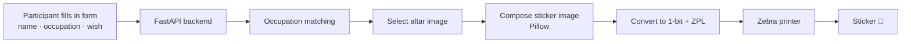

# A Wish for Nehalennia (HackaLOD 2026)

> **Status: draft.** 
>
> Part of the [CIT × HackaLOD](../README.md) repository.

## The idea

Nehalennia was a goddess venerated in the Roman period along the Scheldt estuary, at sanctuaries near Domburg and Colijnsplaat. Travellers and traders set up votive altars to thank her for a safe crossing, and many of those inscriptions name the dedicant's trade: salt traders, pottery traders, shippers, wine and fish-sauce merchants.

That gives us a natural hook. Participants at the HackaLOD enter their **name**, their **occupation** and a **wish for Nehalennia**. We match their occupation to the trades recorded on the altars, pick a matching altar image, and generate a new, personalised "altar" that is printed as a **sticker** to take home.

## How it works



1. The front-end form posts the participant's input to the backend.
2. The backend maps the occupation to one of the trades in our occupation dataset.
3. An altar image associated with that trade is selected from the image subset.
4. Pillow composites the altar image with the participant's name, occupation and wish.
5. The result is converted to a printer-ready format and sent to the Zebra printer.

---

## Data sources

We use a subset of Nehalennia-related images from two datasets in the [NDE Dataset Register](https://datasetregister.netwerkdigitaalerfgoed.nl/):

| Source | Dataset | Used for |
|--------|---------|----------|
| Rijksmuseum | <https://id.rijksmuseum.nl/260250> | Historical prints of the Nehalennia altars 🔍 |
| Rijksmuseum van Oudheden (RMO) | <https://rmo.cithosting.nl/nde/dataset.jsonld> | Object records and images of the altars, inscription data |

 **To verify**
- Check image rights and licences for both sources, and whether reuse on printed stickers is allowed. Record the credit line we need to print or display.

---

## Requirements

### Hardware
- **Zebra label printer** with sticker/label stock 🔍 *(model, DPI and label size still to be confirmed; these determine the image dimensions)*
- Network or USB connection between the machine running the backend and the printer
- A laptop or tablet for the participant-facing form

### Data
- **Occupation dataset** for matching (see [Occupation matching](#occupation-matching))
- **Image subset** of Nehalennia altars, pre-downloaded and stored locally so the tool works without depending on venue Wi-Fi

### Software
- Python 3.11+ 
- [`rdflib`](https://rdflib.readthedocs.io/): parse the RMO RDF/XML and build the occupation dataset
- [`Pillow`](https://python-pillow.org/): image compositing and conversion to 1-bit
- [`FastAPI`](https://fastapi.tiangolo.com/) + `uvicorn`: form endpoint, matching, image generation, print job
- [`rapidfuzz`](https://github.com/rapidfuzz/RapidFuzz): fuzzy string matching for occupations
- HTML/CSS/JS: front-end form (no framework required)
- Optional: a ZPL conversion helper such as [`zebrafy`](https://pypi.org/project/zebrafy/) 🔍 *(evaluate, or write our own `^GF` encoder)*

---

## Technical implementation

### Repository layout (proposed)

```
2026-nehalennia/
├── data/
│   ├── raw/                 # downloaded RDF, not committed if large
│   ├── images/              # altar image subset
│   └── occupations.json     # generated occupation dataset
├── scripts/
│   ├── fetch_images.py      # download the image subset
│   └── build_occupations.py # rdflib: RDF → occupations.json
├── app/
│   ├── main.py              # FastAPI app
│   ├── matching.py          # occupation matching
│   ├── compose.py           # Pillow sticker generation
│   ├── printer.py           # ZPL conversion + sending to printer
│   └── static/              # HTML/CSS/JS front end
├── tests/
├── requirements.txt
└── README.md
```

### Occupation matching

This is the most open part of the design. The proposed approach is a layered one, going from strict to lenient:

1. **Build the trade list from the source data.** Using `rdflib`, extract the inscriptions (or inscription transcriptions/descriptions) from the RMO records and identify the trades that appear, for example *negotiator salarius* (salt trader), *negotiator cretarius* (pottery trader) or *navicularius* (shipper). 🔍 *Check whether inscriptions are available as structured data or only as free text; this determines whether this step is automated or curated by hand.*
2. **Curate a small mapping file** (`occupations.json`) linking each Roman trade to modern Dutch and English synonyms and broader categories. For example, *navicularius* → "schipper, kapitein, logistiek, transport". This file is small enough to maintain by hand and is where most of the "fun" is decided.
3. **Match the participant's input**:
   - normalise the input (lowercase, strip, basic Dutch/English handling);
   - exact or synonym match against the mapping;
   - fuzzy match with `rapidfuzz` if there's no exact hit;
   - fall back to a broad category, or a generic "traveller" altar, so every participant always gets a sticker.

Optionally, a semantic-similarity step could sit between fuzzy matching and the fallback. If we add one, it should sit behind a simple `Matcher` interface so the underlying model or service can be swapped without touching the rest of the code, and it should run locally if possible so the tool keeps working offline at the venue.

**Open questions**
- Link to an external vocabulary (for example Wikidata occupations or HISCO) instead of, or next to, our own mapping?
- How many distinct trades do the altars actually give us? If it's only a handful, the mapping file approach is probably enough.

```python
# app/matching.py (sketch, untested)
from rapidfuzz import process, fuzz

def match_occupation(user_input: str, synonyms: dict[str, str], threshold: int = 80) -> str:
    """Return the Roman trade key that best matches the user's occupation."""
    query = user_input.strip().lower()
    if query in synonyms:
        return synonyms[query]
    hit = process.extractOne(query, synonyms.keys(), scorer=fuzz.WRatio)
    if hit and hit[1] >= threshold:
        return synonyms[hit[0]]
    return "default"
```

### Image generation

Pillow composites the selected altar image with the participant's text:

- scale and crop the altar image to the label size (label width × DPI);
- overlay name, occupation and wish, ideally in a style that echoes a Latin votive inscription (for example `DEAE NEHALENNIAE ...`);
- add a small credit line for the source image;
- convert to **1-bit black and white** with dithering, because Zebra printers print monochrome. Photographs of stone altars can lose a lot of detail here, so test early with real label stock. 🔍

```python
# app/compose.py (sketch, untested)
from PIL import Image, ImageDraw, ImageFont

def compose_sticker(altar_path, name, occupation, wish, size=(812, 1218)):
    img = Image.open(altar_path).convert("L")
    img.thumbnail(size)
    canvas = Image.new("L", size, 255)
    canvas.paste(img, ((size[0] - img.width) // 2, 0))
    draw = ImageDraw.Draw(canvas)
    font = ImageFont.truetype("fonts/inscription.ttf", 36)  # font choice TBD
    draw.text((40, size[1] - 200), f"{name.upper()}\n{occupation.upper()}\n{wish}", font=font, fill=0)
    return canvas.convert("1")  # Floyd–Steinberg dithering by default
```

### Printing

- Convert the 1-bit image to a ZPL `^GF` graphic field (via a helper library or our own encoder).
- Send the ZPL to the printer, either as a raw TCP connection on port 9100 (network printers) or through CUPS as a raw queue (USB).  *Depends on the printer we get.*
- Queue print jobs so two submissions at the same moment don't collide.
- Keep a "dry run" mode that saves the PNG and ZPL to disk instead of printing, for development without the printer.

### API (proposed)

| Method | Endpoint | Description |
|--------|----------|-------------|
| `GET` | `/` | Serves the front-end form |
| `POST` | `/wish` | Receives `name`, `occupation`, `wish`; returns a preview and a job id |
| `POST` | `/print/{job_id}` | Sends a confirmed sticker to the printer |
| `GET` | `/health` | Checks the app and printer connection |

Showing a preview before printing lets participants check their text and saves label stock.

---

## Getting started

```bash
git clone <repo-url>
cd cit-hackalod/2026-nehalennia
python -m venv .venv && source .venv/bin/activate
pip install -r requirements.txt

# 1. Prepare the data
python scripts/fetch_images.py
python scripts/build_occupations.py

# 2. Run the app (dry-run mode, no printer needed)
PRINTER_MODE=dry-run uvicorn app.main:app --reload
```

Then open <http://localhost:8000>.

Configuration (printer address, label size, DPI, print mode) goes in environment variables or a `.env` file. 🔍 *Exact variable names to be decided.*

> All code in this repository should be tested in a test environment, and with the actual printer and label stock, before it's used at the event.

---

## Privacy

Participants enter their name and a personal wish, which counts as personal data under the GDPR (AVG). Proposed approach:

- don't store submissions; generate the sticker in memory and discard the input after printing;
- if anything is logged for debugging, leave out names and wishes;
- if we want to keep examples (for example for a presentation), ask participants explicitly and separately.


---

## To do / open questions

- [ ] Confirm the Rijksmuseum dataset scope and the RMO distribution to use
- [ ] Check image licences and credit lines
- [ ] Decide on the occupation-matching approach and build `occupations.json`
- [ ] Confirm Zebra printer model, DPI and label size
- [ ] Test 1-bit dithering of altar images on real label stock
- [ ] Choose a font for the inscription-style text
- [ ] Design the front-end form (Dutch and/or English?)
- [ ] Privacy check

---

## Team

Kelly Davis, hoofd, Collectie IT
Jeroen de Meester, applicatiebeheerder, Collectie IT
Digna van Nielen, functioneel beheerder, Collectie IT
Fricke Oosten, informatiespecialist, Collectie Informatie & Archief
Minh Tran, data engineer, Collectie IT


## Licence
*To be decided (for example MIT or EUPL for code). Note that images and data keep the licences of their original sources.*
